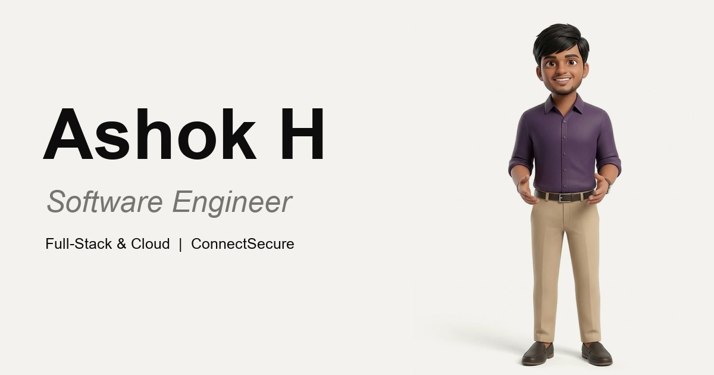

# Ashok H — Software Engineer Portfolio

[**Ashok H Portfolio**](https://github.com/AshokTechie)



An exact, pixel-perfect, clean and quiet personal portfolio website for **Ashok H**, Software Engineer at ConnectSecure. Built with **Next.js 15 (App Router)**, **React 19**, **TypeScript**, **Tailwind CSS 4**, and **Lenis**.

All personal content is sourced strictly from Ashok H's resume and structured in `src/lib/data.ts`.

---

## Highlights & Features

- **Hero Section**: Elegant typography with split text reveal masks, ghost background initials, interactive intro sound trigger, and direct access to work, contact, and downloadable resume PDF.
- **Hanging Lanyard ID Card**: Interactive 3D pendulum physics card with realistic momentum, sway physics, and double-sided flip (Enter/Space, hover, or click) revealing profile details, barcode, and hologram styling.
- **Periodic Table of Skills**: Interactive periodic table of Ashok H's complete tech stack (Languages, Frameworks, Databases, Tools & Cloud, Core Foundations) with atomic numbers, 2-letter chemical symbols, family filter chips, and an inspector card with tech logos and real-world project usage context.
- **Accordion Projects (Work)**: Multi-panel interactive accordion showcasing:
  1. *Conversational AI Agent – Agentic RAG System* (LangGraph, Python, Qdrant, Gemini API, HuggingFace)
  2. *Smart Agriculture ML System* (Python, GCP, Firebase, ESP32)
  3. *Car Rental Platform* (Node.js, Express, React, MongoDB, Docker)
  Each featuring custom illustrative mini-UIs, feature tags, and technology badges.
- **Core Foundations & Coursework**: High-precision hover-fill list highlighting Data Structures & Algorithms, Object Oriented Programming, Computer Networks, Operating Systems, Academic Honors, and UVCE B.Tech credentials.
- **Interactive Experience & Education Timeline**: Scroll-drawn timeline tracing Ashok H's engineering journey at ConnectSecure and UVCE with active indicator lights that light up as you scroll.
- **Honours & Metrics (Pinned Horizontal Scroll)**: Smooth pinned horizontal gallery with animated count-up numbers for key quantifiable achievements (95%+ RAG accuracy, <200ms vector search latency, 85%+ predictive ML accuracy, 100+ readings/min zero-loss telemetry, <2s end-to-end latency, and 8.76 CGPA distinction).
- **Interactive Contact & Rotating Badge**: Hopping-letters headline, one-click email copy with feedback state, spinning badge, and direct links to GitHub, LinkedIn, and Phone.
- **Accessibility & Motion**: Zero external runtime scripts, full keyboard navigation, self-hosted fonts (`Inter Tight`, `Instrument Serif`, `JetBrains Mono`), and comprehensive `prefers-reduced-motion` compliance.

---

## Tech Stack

- **Framework**: Next.js 15.5+ (App Router, Static HTML Export)
- **UI Library**: React 19, TypeScript
- **Styling**: Tailwind CSS 4, scoped CSS
- **Smooth Scroll**: Lenis
- **Self-Hosted Fonts**: Inter Tight, Instrument Serif, JetBrains Mono
- **Assets**: Optimized WebP and SVG brand logos

---

## Project Structure

```
├── public/
│   ├── cv.pdf                   # Ashok H resume PDF
│   ├── Ashok-H-Resume.pdf       # Downloadable resume
│   ├── portrait-bust.webp       # ID card portrait
│   ├── og.jpg                   # OpenGraph social card
│   ├── favicon.ico              # Site favicon
│   ├── hero/                    # Hero visual assets
│   └── logos/                   # Official SVG brand logos
├── src/
│   ├── app/
│   │   ├── globals.css          # Design tokens, reset, utility classes
│   │   ├── layout.tsx           # Metadata, OG tags, local fonts
│   │   └── page.tsx             # Root page entry
│   ├── components/
│   │   ├── App.tsx              # Main application shell with Lenis
│   │   ├── Navigation.tsx       # Floating glass pill navbar & mobile menu
│   │   ├── hero/Hero.tsx        # Hero section with audio intro
│   │   ├── sections/
│   │   │   ├── About.tsx        # Bio, quick facts & ID card
│   │   │   ├── Skills.tsx       # Periodic table of stack
│   │   │   ├── Work.tsx         # Expanding project accordion
│   │   │   ├── Certifications.tsx # Core foundations & coursework
│   │   │   ├── Experience.tsx   # Scroll-drawn timeline
│   │   │   ├── Achievements.tsx # Pinned horizontal metrics cards
│   │   │   └── Contact.tsx      # Contact section & footer
│   │   └── ui/                  # Reusable UI components (IdCard, TechLogo, etc.)
│   └── lib/
│       ├── data.ts              # Single source of truth (Ashok H resume data)
│       ├── hooks.ts             # Custom viewport & scroll hooks
│       ├── scroll.tsx           # Lenis smooth scroll provider
│       └── asset.ts             # Static asset resolver helper
└── package.json
```

---

## Getting Started

### Prerequisites

- Node.js 20+ (Node.js 22 recommended)
- npm or pnpm

### Installation

```bash
npm install
```

### Development Server

Run the development server locally:

```bash
npm run dev
```

Open [http://localhost:3000](http://localhost:3000) in your browser.

### Production Build & Export

To create an optimized static production build:

```bash
npm run build
```

This generates a fully static export in the `out/` directory, ready to deploy to GitHub Pages, Vercel, Netlify, Cloudflare Pages, or AWS S3.

### Local Production Preview

To test the exported build locally:

```bash
npx serve out
```
